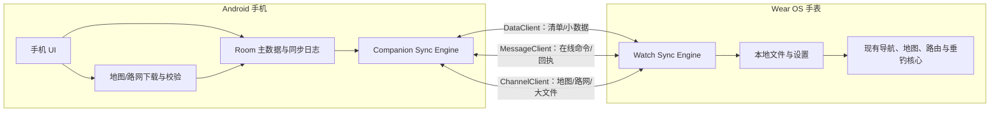
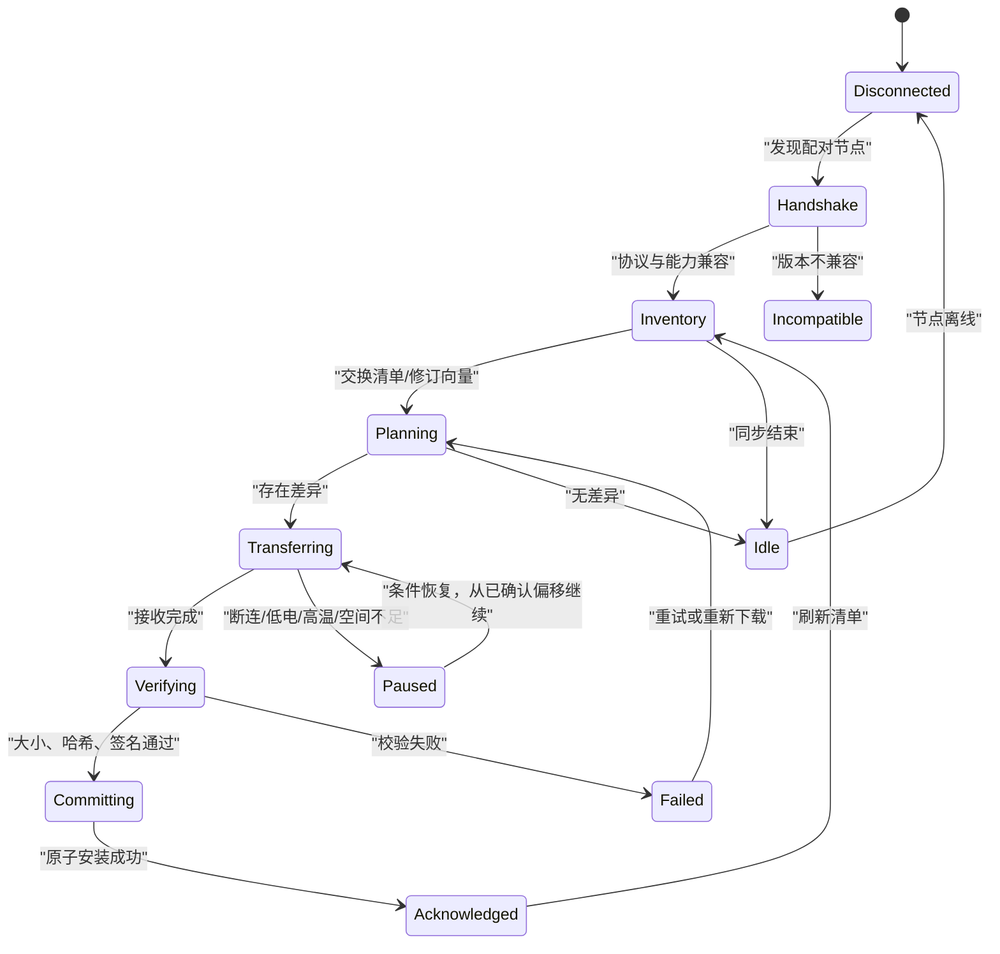

# WatchNav 手机伴侣 App 设计方案

版本：1.2

适用基线：WatchNav Wear OS 0.20.35 / Android Companion 0.20.26

目标平台：Android 手机 + Wear OS 手表

> 本文保留完整产品方案与数据源边界。当前代码实现、运行阈值和真机验证结果以
> [TECHNICAL_ARCHITECTURE.md](TECHNICAL_ARCHITECTURE.md) 与根目录 [CHANGELOG.md](../CHANGELOG.md) 为准。

## 1. 方案目标

手机 App 的定位不是“手表 App 的遥控器”，而是 WatchNav 的**大屏管理端、下载加速端和数据归档端**。手表继续承担户外现场最关键的定位、离线地图、离线路由、导航、TracBack、钓点记录、气压与 Solunar/潮汐判断；即使手机关机、离开、无网络或手机 App 被卸载，手表已有功能仍可独立使用。

核心原则如下：

1. **手表独立优先**：导航中不依赖手机持续连接，不把 GPS、路由或告警计算搬到手机。
2. **手机承接重任务**：地图选区、批量下载、路线编辑、钓点详情、历史统计、备份与复杂设置优先在手机完成。
3. **本地优先、云端可选**：第一版不要求账号和云服务；手机与手表可以只通过 Wear OS 配对链路同步。
4. **先落盘、再生效**：任何同步数据先写入接收端临时区，校验成功后原子替换，避免断线造成半张地图或损坏路线。
5. **明确数据主权**：现场原始记录以手表为准；手机编辑内容可同步回表；冲突不能静默覆盖。
6. **传输可恢复**：地图、等高线、海图、历史影像和 BRouter 路网必须支持中断后续传，并显示剩余空间、速度和预计时间。
7. **来源合规可追溯**：每个地图图层都保存来源、授权、采集日期、分辨率、坐标系和有效期；不抓取未授权瓦片或破解第三方离线缓存。

## 2. 现有手表能力基线

方案直接复用现有工程，而不是另建一套不兼容的数据体系。

| 现有能力 | 当前手表存储/模块 | 手机端扩展方向 |
|---|---|---|
| Mapsforge 离线地图 | `map-mapsforge`，`files/maps/active.map` | 大屏框选、手机高速下载、校验后发送到手表 |
| BRouter 离线路网 | `brouter-engine`，5°×5° `.rd5` 区域 | 自动计算选区所需路网并随地图一并下发 |
| 区域包与断点下载 | `package-manager`，Ed25519 清单、SHA-256、`.part` | 把同一套下载和校验逻辑复用到手机；增加跨设备续传 |
| GPX/KML 路线库 | `CourseFileStore`，支持 WGS-84/GCJ-02/BD-09 导入 | 批量导入、地图编辑、搜索、路线规划、下发与版本管理 |
| 轨迹与活动 | `TrackStore`、`ActivityArchive`，GPX/FIT | 自动回传、手机地图回放、统计、导出和备份 |
| 普通钓点 | `WaypointStore` | 完整字段编辑、分类、搜索、地图聚合 |
| 语音钓鱼记录 | `FishingEnvironmentStore` | 补充鱼种、尺寸、重量、饵型、照片、天气和备注 |
| 气压/Solunar/潮汐 | 本地压力样本、`FishingMath`、潮汐缓存 | 长周期趋势图、完整预测窗口、手机预取潮汐后下发 |
| 功耗与显示设置 | 精准/均衡/远征、常亮、地图跟随、触控锁 | 手机集中配置并同步，手表仍可独立修改 |
| 历史卫星影像 | 尚无 | 手机按拍摄日期下载、离线缓存和对比；只向手表发送小选区参考切片 |
| 海图/等深线/水体边界 | 仅地形等高线 | 手机多图层管理；向手表发送简化矢量/栅格区域包 |
| 公共设施/公共下钓点 | 仅用户本地钓点 | 建立带来源、开放状态和更新时间的离线 POI 索引 |
| 文件分享 | GPX/FIT 导出为主 | 补齐 GPX、KML/KMZ 的导入、导出、系统分享与隐私处理 |

当前文件结构适合单机，但多数实体缺少稳定 UUID、修订号和删除标记。正式同步前应先完成数据模型升级，避免用文件名或毫秒时间戳直接充当跨设备身份。

## 3. 双端职责边界

### 3.1 手机负责

- 大屏地图浏览、地点搜索、矩形/多边形区域选择和容量估算。
- 普通地图、历史卫星影像、地形等高线、离线海图、水下等深线、水体边界、POI 索引和 BRouter 路网的下载、断点续传、完整性验证和同步排队。
- GPX/KML/KMZ 导入、坐标系选择与纠偏、路线编辑、途经点/钓点备注、路线规划、系统分享和批量管理。
- 钓鱼记录的完整查看与编辑：鱼种、长度、重量、数量、饵型、钓法、水层、照片、语音原文、气压、潮汐、月相、位置与隐私等级。
- 活动历史、轨迹回放、统计报表、GPX/FIT/CSV/JSON 导出和本地备份。
- 潮汐 API 密钥等敏感配置的安全保存；优先由手机下载预测结果，再把不含密钥的缓存下发到手表。
- 手表连接、存储、电量、温度、版本、数据包和同步队列管理。

### 3.2 手表继续独立负责

- GNSS 定位、航向/气压/海拔传感器采集、轨迹记录。
- Mapsforge 离线地图显示、BRouter 离线路由、偏航重算、返航与 TracBack。
- 导航和安全告警，包括气压骤降、偏航、到达和路线提示。
- 离线查看已安装路线、地图、路网、钓点、潮汐缓存与 Solunar 结果。
- 快速钓点/语音钉记录；手机不在时先本地保存，重连后再同步。
- 继续保留手表端地图/路网下载、文件导入和全部关键设置入口，避免形成手机强依赖。

### 3.3 明确不做

- 不让手机实时替手表计算导航，否则断连会中断导航。
- 不在首版引入强制登录、强制云备份或订阅才能同步。
- 不把地图文件直接写进正式目录；校验和事务提交之前只能存在临时区。
- 不默认把精确钓点上传到互联网。

## 4. 手机 App 信息架构

底部采用五个一级入口，使常用任务不超过两层。

### 4.1 首页

首屏是一张“出钓准备卡”，显示：

- 手表在线/离线、上次连接时间、手表电量和可用空间。
- 待同步数量、传输进度、失败任务与“立即同步”。
- 当前区域离线准备度：地图、等高线、路网、潮汐、路线分别显示已就绪/缺失/过期。
- 今日 Solunar 四级活性、气压趋势、最近高潮/低潮和转流黄金窗口。
- 快捷操作：准备离线区域、发送路线、查看最新钓获。

首页只给结论；点击卡片进入完整数据，不复制手表导航主界面。

### 4.2 地图与下载

这是解决“手表下载慢、圆屏选区困难”的核心界面。

1. 在全屏地图中搜索地点，或使用手机当前位置、路线包络范围、历史钓点范围作为选区。
2. 支持矩形、多边形和“沿路线缓冲区”三种范围；显示预计覆盖面积。
3. 用户选择数据层：
   - 基础 Mapsforge 地图；
   - 历史卫星影像；
   - 地形等高线、海图、水下等深线与水体边界；
   - 公共设施、公共下钓点与危险/禁入区域；
   - BRouter 路网；
   - 潮汐、水位与后续水文数据。
4. 下载前展示手机占用、手表新增占用、现有可复用文件、预计下载时间和预计传表时间。
5. 手机先完成网络下载和 SHA-256 校验，再进入“发送到手表”队列。
6. 手表校验并安装后返回明确回执；手机才将任务标为完成。

下载任务支持暂停、恢复、仅下载到手机、稍后传表、仅 Wi-Fi、充电时传输，以及低电量/高温自动暂停。

#### 4.2.1 历史卫星影像与枯水结构对比

在历史影像尚未导入时，手机端先自动建立“当前卫星底图”：使用 EOX 的 Sentinel-2
Cloudless 2025 全球无云合成 WMTS，在当前路线中心（无路线时使用手机最后定位）下载
1–15 km 半径、Web Mercator 10–14 级瓦片，并现场生成可断点续传的 MBTiles。图面必须显示
`EOX · Contains modified Copernicus Sentinel data 2025`；该默认源按 CC BY-NC-SA 4.0
用于非商业场景。商业部署必须换用获得商业授权的 EOX、ArcGIS、天地图或其他影像源。

当前卫星底图用于保证“卫星地图”入口始终有可用内容，不取代按日期筛选的历史影像。
Sentinel-2 约 10 m 基础分辨率适合识别河道、滩地、湾汊和大型结构，不能冒充亚米级航拍图。

手机端新增“历史影像”模式，主要服务于水库、湖泊与河道在不同水位下的结构研判。

本方案将需求中的“维奥”按“奥维互动地图”理解；若实际指另一数据平台，只需增加对应的合规图源适配器，不改变总体架构。

- 按年份、月份、拍摄日期、云量和空间分辨率筛选影像；每张影像必须显示来源和采集时间，不能只标“卫星图”。
- 提供四种对比：时间滑杆、左右分屏、手指擦除镜头、A/B 快速闪烁。用户移动地图时两期影像保持同中心、同缩放级别。
- 可以把潮位、水库水位或用户输入的水位值绑定到影像日期，优先推荐“低云量 + 低水位”的枯水期影像。
- 支持在影像上标注旧河道、沟槽、陡坎、台地、路基、桥基、乱石、沉水植被和疑似深坑，并标注“人工判断/自动推测”与可信度。
- 结构标记默认是私人数据；只有用户明确选择后才可发布为公共标点。
- 历史影像体积很大，完整时间序列默认只保存在手机。发送到手表时选择一个日期、一个小范围和有限缩放级别，生成“参考影像包”；手表不承担多期影像浏览。

数据源采用插件式适配器，按以下优先级接入：

1. 官方或已授权的 WMTS/WMS/XYZ、STAC/OGC API、商业影像 API；
2. 用户拥有使用权的 GeoTIFF、MBTiles、航拍正射影像；
3. 奥维互动地图的官方第三方接口、企业 WEB 瓦片服务或用户依法导出的标准文件。

奥维官方支持多时相自定义影像和 WEB 瓦片服务，也提供标签、轨迹、路线等对象的第三方接口，但这不等于可以复制其内置商业图源。WatchNav 不直接读取奥维加密缓存、不复用会员令牌、不绕过下载限制；只有获得离线使用与再分发授权的图层才能进入 WatchNav 缓存。参考 [奥维第三方接口](https://www.ovital.com/openapi/) 与 [奥维多时相影像说明](https://www.ovital.com/147525/)。

可优先评估的开放来源包括 Copernicus Data Space 的 Sentinel 历史数据与 STAC/WMTS 接口；对于更长时间跨度，可使用 Landsat/JRC 数据。开放中分辨率影像适合识别大尺度旧河道和水面变化，不应宣传为能看清所有小型水下障碍物。

#### 4.2.2 离线海图、等深线与水体边界

“水域图层”分成三类，避免把不同精度的数据混成一张看似精确的图：

- **法定/官方海图**：S-57/S-101 ENC 或经授权的离线 MBTiles，包含航标、浅滩、碍航物、航道、岸线等；按国家/水域接入。NOAA ENC 可覆盖美国海岸和五大湖，并提供离线 MBTiles；其他地区通过当地海道测量机构或持牌经销商获取。
- **水深地形**：GEBCO 等全球格网、地方水利/渔业公开数据、用户导入的测深/声呐数据。必须显示原始分辨率、垂直基准、年份和数据质量；GEBCO 当前全球格网为 15 arc-second，适合宏观海底地形，不适合假装成小水库的高精度等深线。参考 [GEBCO 格网数据](https://www.gebco.net/data_and_products/gridded_bathymetry_data/)。
- **水体边界**：当前水体、多年最大水面、季节性水面和枯水期边界。可结合 OSM 水体矢量与 JRC Global Surface Water 1984–2024 年水面历史，生成“常年水域/季节水域/曾经水域”三类边界。参考 [JRC Global Surface Water 数据](https://global-surface-water.appspot.com/download)。

手机可把栅格深度生成可配置间距的矢量等深线，并裁剪为小区域包发送到手表。手表端只保留核心深度色带、主/次等深线、航道、危险物和岸线，避免圆屏过载。

海图页面必须长期显示：“垂钓辅助资料，不能替代最新官方海图、航行通告、测深仪或安全观察。”数据过期、精度未知或垂直基准不明时使用醒目标识，不能用于自动判定安全水深。

#### 4.2.3 公共设施与公共下钓点

新增可离线搜索的“水域 POI 包”，至少包含：

- 公共下钓点、钓鱼平台、岸边入口、码头、船艇下水坡道；
- 停车场、厕所、饮用水、渔具店、加油/充电、露营点、避雨点；
- 救援站、医院、紧急电话、危险岸段、泄洪口、高压线、禁钓/禁入区。

公共数据可以从 OpenStreetMap 及政府开放数据中提取；OSM 的 `waterway=access_point` 等标签可表达水域入口、是否允许钓鱼以及附近停车/饮水条件，但须遵守 ODbL 署名与衍生数据库要求。参考 [OSM 水域入口标签](https://wiki.openstreetmap.org/wiki/Tag%3Awaterway%3Daccess_point) 和 [OSM 版权许可](https://www.openstreetmap.org/copyright)。

每个公共点必须带有：来源、最后核验时间、开放/收费/预约状态、步行距离、停车条件、岸型、无障碍情况、风险等级和用户纠错入口。社区提交先进入待审核状态，做重复点合并、坐标异常检测和管理方/现场照片核验；私人水域、保护区敏感点及未经确认的危险入口不得直接标为“公共下钓点”。

#### 4.2.4 图层目录与离线存储

手机地图采用“图层目录”而不是单一底图。每个图层统一保存：

```text
layerId / providerId / title / dataType
bounds / minZoom / maxZoom / timeRange
horizontalCrs / verticalDatum / resolution
license / attribution / offlineAllowed / expiresAt
contentHash / downloadedBytes / sourceUpdatedAt
```

栅格影像优先采用按时间切片的 MBTiles/分块存储，矢量设施与水体采用带空间索引的本地数据库，官方 ENC 保留源格式或转换为具备来源追踪的渲染包。`files/maps/active.map` 仍服务手表现有 Mapsforge 底图，但手机端和未来手表叠加层需要新增 `LayerCatalog` 与多文件仓库，不能把历史影像、海图和水深数据硬塞进一个 `active.map`。

#### 4.2.5 GPX、KML/KMZ 导入与分享

- 从系统文件选择器、Android 分享菜单、微信/邮件/网盘等“用其他应用打开”入口接收 GPX、KML 和 KMZ。
- 导入前预览轨迹、航点、边界和数量，选择 `WGS-84 / GCJ-02 / BD-09`；保存时统一转为 WGS-84，并记录原坐标系。
- KML/KMZ 支持路线、Placemark、Polygon、样式和 `ExtendedData`；GPX 支持 track、route、waypoint 以及 WatchNav 扩展字段。
- 可分享单条路线、活动轨迹、选定钓点、公共设施清单或一个完整离线出钓包；Android Sharesheet 输出真实文件 URI，不暴露 App 私有目录。
- 分享私人钓点前提供三个位置选项：精确位置、随机模糊 100/500/1000 米、完全移除坐标；默认不携带照片 EXIF 原始位置。
- “WatchNav 出钓包”可包含 GPX/KML、标点、来源与版本清单，但地图/卫星/海图内容只有授权允许再分发时才能打包；否则只分享下载清单和来源链接。

### 4.3 路线

- 列表支持名称、距离、地区、日期、收藏、是否已在手表等筛选。
- 导入 GPX/KML 时显式选择 `WGS-84 / GCJ-02 / BD-09`，统一转换为 WGS-84 后保存。
- 详情页展示路线、海拔剖面、预计时长、起点推荐、所需地图/路网和沿途备注。
- 编辑器支持拖动起终点、增加途经点、添加钓鱼点/危险点/补给点，必要时在手机调用同一 BRouter 引擎离线规划。
- 发送路线时自动检查手表缺失的 `.rd5` 和地图区域，允许“一键准备路线”：路线 + 地图 + 等高线 + 路网打成一个同步计划。
- 手表结束导航形成的优秀轨迹同步到手机后，可编辑名称、裁剪、简化并保存回手表路线库。

### 4.4 钓获与钓点

采用“地图 + 时间线 + 详情”三种视图。手表端只负责快速记录，手机端负责信息补全。

建议钓获实体字段：

- 基础：鱼种、数量、长度、重量、放流/带走、时间；
- 技法：饵型、饵色、钓法、水层、抛投方向；
- 环境：位置、海拔、气压及 3 小时趋势、水温、盐/淡水、潮位、潮流、月相、Solunar 等级；
- 媒体：语音原文、人工修订文本、照片和短视频；
- 管理：标签、评分、是否“优秀钓点”、隐私等级、关联活动/路线。

照片原图默认只保存在手机；向手表发送时只生成小缩略图，避免挤占手表空间。用户在手机修改鱼种或备注后同步回表，手表显示适合圆屏的摘要。

### 4.5 设备与设置

分为四组：

- 导航：默认运动模式、偏航阈值、自动暂停、地图跟随、航向朝上。
- 功耗与显示：精准/均衡/远征、常亮、亮度策略、振动强度、触控锁。
- 垂钓：水域类型、水温、气压风暴阈值（默认 3 小时下降超过 4 hPa）、72 小时气压孔维护提醒、潮汐刷新策略。
- 同步与存储：自动同步条件、仅 Wi-Fi、充电时大文件传输、地图保留、手表空间清理、备份与恢复。

每个设置项标注“手机专用”“同步到手表”或“仅本手表”。修改后显示“待发送”，收到手表应用回执才显示“已生效”。手表上的修改也反向同步到手机。

## 5. 技术架构



Android 官方建议：`DataItem` 用于可持久同步的小数据，裸负载上限 100 KB；`MessageClient` 适合在线 RPC，但没有持久化和内建重试；`ChannelClient` 适合大文件流，并由应用负责一致性。因此采用三通道分工，而不是用单一消息接口传所有内容。参考 [Data Layer 概览](https://developer.android.com/training/wearables/data/overview)、[客户端类型选择](https://developer.android.com/training/wearables/data/client-types) 和 [DataItem 同步](https://developer.android.com/training/wearables/data/data-items)。

Data Layer 只负责运输，不作为业务数据库。手机使用 Room，手表继续使用本地文件/SharedPreferences，逐步迁移到带版本的仓库接口。两端收到数据后必须持久化自己的副本；官方也明确建议不要把 Data Layer 当存储层。

### 5.1 建议新增工程模块

```text
mobile-app/          Android 手机应用，applicationId 与签名和手表一致
sync-protocol/       纯 Kotlin：协议模型、版本、UUID、哈希、冲突规则
sync-transport/      Android Library：Data/Message/Channel 客户端封装
data-repository/     可选：路线、钓点、活动、设置的仓库接口与迁移器
map-source-api/      图源适配器、授权能力、时间维度与图层元数据
hydro-data/          ENC/水深/水体边界解析、裁剪与等深线生成
import-export/       GPX/KML/KMZ/GeoJSON 与 WatchNav 出钓包
```

继续复用 `nav-core`、`routing-api`、`brouter-engine` 和 `package-manager`。其中 `package-manager` 应把“下载到哪个目录”和“安装到哪个仓库”抽象为接口，使手机能复用断点下载、签名清单和 SHA-256 校验，而不引用手表专用 UI。

`RegionArtifactType` 从目前的 `MAPSFORGE`、`BROUTER_RD5` 扩展为 `POI_INDEX`、`HISTORICAL_RASTER`、`ENC_CHART`、`BATHYMETRY`、`WATER_BOUNDARY` 和 `TIDE_CACHE`。每类数据有独立校验器和安装目标，区域包清单同时记录许可与署名；不允许手机把“可查看但禁止离线/再分发”的在线图层发送到手表。

Data Layer 要求手机与手表应用使用相同包名和相同签名才能互通。因此手机模块应继续使用 `com.watchnav.app`，作为同一产品的 handheld 变体发布；构建和签名配置必须统一。

手表清单中的 `com.google.android.wearable.standalone=true` 必须保留。它明确表达手表可自行联网并完成核心任务；加入手机伴侣模块不应改变这一产品承诺。

## 6. 数据模型与所有权

所有可同步实体统一增加：

```text
id: UUID
schemaVersion: Int
revision: Long
updatedAtUtc: Long
updatedBy: PHONE | WATCH
deleted: Boolean
contentHash: SHA-256
```

| 数据类型 | 权威来源 | 同步方向 | 冲突策略 |
|---|---|---|---|
| 原始轨迹、活动、传感器样本 | 手表 | 手表 → 手机 | 追加为主，不覆盖原始记录 |
| 快速钓点/语音钉 | 手表首次创建 | 双向 | 不同字段合并；同字段冲突保留两个版本供选择 |
| 手机补全的钓获详情/照片 | 手机 | 手机 → 手表摘要 | 原图留手机，手表只收摘要/缩略图 |
| 路线、途经点、备注 | 最近编辑设备 | 双向 | `revision` 比较；并发编辑生成“冲突副本” |
| 设置 | 按键定义所有权 | 双向 | 每项独立版本；手表安全设置优先 |
| 地图/等高线/路网包 | 不可变内容包 | 手机 → 手表为主 | 按 `packageId + version + hash` 去重 |
| 潮汐预测缓存 | 获取方 | 双向 | 新鲜度和位置覆盖范围优先 |
| API 密钥、账号令牌 | 手机/本设备 | 默认不同步 | Android Keystore 保存，只传派生结果 |

删除不能立即物理移除同步记录，应写入 tombstone 并保留 30 天，防止离线设备重连后把旧数据“复活”。用户手动清理地图只删除该设备副本，不默认删除手机缓存。

## 7. 同步协议与状态机



### 7.1 握手

交换以下内容：协议版本、App 版本、设备 ID、支持功能、剩余空间、电量/充电/温度状态、已安装包摘要、最后同步游标。协议采用向后兼容字段；旧端忽略未知字段。重大不兼容时仍允许两端独立运行，只禁用同步并给出升级提示。

### 7.2 小数据同步

- 用 `DataItem` 传同步游标、实体差异清单、设置快照和任务状态。
- 单项业务负载控制在 64 KB 内，超过则拆分页或作为大文件处理。
- 需要立即响应的“开始同步/暂停/取消/获取状态”可用 `MessageClient`，但真正的任务状态必须另行落盘，不能依赖消息必达。
- 非紧急数据合并批量发送；用户主动点击“立即同步”才使用 urgent，降低电量消耗。

### 7.3 地图和路网大文件

大文件经 `ChannelClient` 流式传输，应用层实现恢复能力：

1. 手机生成传输清单：`transferId`、包类型、文件名、长度、SHA-256、分块大小和最终安装目标。
2. 手表检查空间、版本和已有 `.part`，返回可续传偏移或已完成分块位图。
3. 默认按 4 MiB 分块发送；每 16 MiB 或 5 秒回传一次持久化确认。
4. 断线后保留临时文件与进度；重连从最后确认块继续，不重传整个地图。
5. 完成后手表先校验长度和 SHA-256，再校验区域包 Ed25519 清单。
6. 写入 staging，解析 Mapsforge 边界或验证 `.rd5` 文件后原子安装；失败保留旧版本并回滚。
7. 手表回传 `INSTALLED` 回执，手机更新资产清单。

由于 Data Layer 可能走蓝牙、Wi-Fi，甚至经端到端加密的 Google 中继，界面不应承诺固定带宽。超过 100 MB 时默认提示连接同一 Wi-Fi、手表充电并保持足够散热；无 Wi-Fi 时允许继续，但明确显示速度较慢。若用户要求完全局域网、不经中继，可在后续版本增加“仅附近设备”策略，但仍不应绕过官方 Data Layer 建立未经管理的低层配对通道。

## 8. 离线区域的一键准备

手机端把原来分散的下载动作组织成“离线区域计划”：

```text
用户选区域/路线
  → 计算 Mapsforge 覆盖
  → 计算等高线包覆盖
  → 按 5° 网格计算 BRouter rd5 列表
  → 检查手机缓存和手表库存
  → 只下载缺失版本
  → 校验
  → 按依赖顺序传表（路网 → 地图 → 路线 → POI/潮汐）
  → 手表安装后执行一次离线路由自检
```

“已就绪”必须同时满足：地图可打开、路线在区域内、所需路网齐全、剩余空间高于安全阈值。若地图成功而路网失败，状态显示为“可看图、不可规划”，不能笼统显示下载完成。

手机保留最近使用区域的缓存。再次给同一手表或新手表安装时无需重新联网下载；但用户可在设置中限制手机缓存容量。

## 9. 潮汐、Solunar 与环境数据协作

- Solunar 四级活性继续由两端共享的纯 Kotlin 算法根据时间、WGS-84 经度本地计算，离线可用。
- 手表继续采集现场气压，并以手表时间序列为权威；手机只做长周期图表和关联分析。
- 3 小时下降超过 4 hPa 的高优先级风暴告警必须在手表本地触发，不依赖同步。
- 72 小时气压孔维护提醒由手表本地计时；手机也显示维护历史，任一端确认后同步确认时间。
- 潮汐 API 密钥默认只放手机 Keystore。手机可预取目标区域未来 2–7 天潮汐并下发缓存，手表离线显示涨退潮、高潮/低潮及转流前后 15 分钟窗口。
- 为保持独立性，手表仍保留本机 API 密钥和直接刷新入口；若两端都有数据，选择位置更接近且更新时间更新的缓存。

## 10. 安全、隐私与可靠性

- Data Layer 只允许相同包名和签名的两端访问，传输链路由 Google Play 服务加密；应用仍要验证业务包签名和 SHA-256。
- 精确钓点属于高敏感数据，默认仅本地，地图分享/导出前可做 100–1000 米坐标模糊化。
- API 密钥、令牌使用 Android Keystore 加密，不写日志、不放同步清单。
- 手机备份默认生成加密的 WatchNav Archive；用户明确选择后才导出明文 GPX/KML/CSV。
- 数据库迁移失败时只读打开旧数据并生成备份，不自动清空。
- 手表空间不足时不删除当前活动、当前路线、活动地图或唯一一份钓获记录；清理建议按“可重新下载的旧地图”优先。
- 所有导入仍执行现有大小限制、坐标范围校验、XML 外部实体禁用和 HTTPS/重定向检查。

## 11. 手表端需要增加的最小界面

不增加复杂页面，只在现有“功能”面板加入一个“手机同步”入口：

- 手机状态：已连接/离线、手机名称、上次同步时间。
- 当前任务：文件名、类型、百分比、速度、预计剩余时间。
- 操作：立即同步、暂停/继续、取消本任务、仅充电时接收。
- 存储：地图、路网、路线、活动和钓获分别占用多少空间。
- 错误：空间不足、版本不兼容、校验失败等可理解文案。

导航进行中默认不自动接收大文件；小型路线/设置同步可以继续，地图传输排队到导航结束或用户明确允许。

## 12. 后台任务与功耗策略

手机用 WorkManager 负责网络下载、潮汐预取和可重试队列；大文件发送使用用户可见的前台任务与通知。手表接收期间使用前台服务，但必须设置以下门槛：

- 默认手表电量低于 30% 且未充电时不启动大文件；
- 检测到高温、导航中或存储低于“文件大小 + 128 MiB 安全余量”时暂停；
- 屏幕熄灭后传输可继续，不强制常亮；
- 合并数据库差异，避免每条轨迹点产生一次无线唤醒；
- 活动轨迹按活动完成后或每 15 分钟批量镜像，频率可配置。

## 13. 兼容与异常降级

| 场景 | 预期行为 |
|---|---|
| 手机不在/关机 | 手表全部现有离线功能正常；数据进入待同步队列 |
| 手表不在 | 手机可继续编辑、下载和排队，不能显示“已在手表” |
| 传输中断 | 保留 `.part` 和确认偏移，重连后续传 |
| 手机 App 被卸载 | Data Layer 缓存可能被重置，但手表本地业务数据不受影响 |
| 手机更换 | 从加密备份恢复手机库，再与手表交换清单；不以空手机覆盖手表 |
| 两端同时修改路线 | 生成冲突副本，让用户对比合并，不静默覆盖 |
| 旧版手表 | 只启用双方都声明支持的能力；手机提示升级，不影响手表单机使用 |
| 地图完成、路网缺失 | 明确标注“仅地图可用”，提供补齐路网动作 |
| 校验失败 | 不安装，旧包继续使用；删除损坏临时块后重试 |

## 14. 分阶段实施路线

### 阶段 0：同步前的数据基础

- 新建 `sync-protocol`，定义 UUID、revision、tombstone、能力握手和传输清单。
- 为 `CourseFileStore`、`WaypointStore`、`FishingEnvironmentStore`、`ActivityArchive` 增加仓库接口和旧数据迁移。
- 为地图、路网和潮汐缓存建立统一 inventory，补充大小、边界、版本和哈希。
- 保证迁移前后手表独立功能与文件导出完全一致。

### 阶段 1：手机 MVP 与小数据同步

- 新建 `mobile-app`、配对状态、设备首页和同步日志。
- 完成设置、路线、普通钓点、钓获摘要、活动摘要双向同步。
- 完成 GPX/KML/KMZ 手机导入、坐标系转换、导出和 Android 系统分享。
- 手表增加最小“手机同步”状态页。

### 阶段 2：离线地图中心

- 手机上的区域选择、地图/等高线/路网依赖计算和下载队列。
- `ChannelClient` 大文件分块、持久 ACK、断点续传、SHA-256、原子安装与回滚。
- 一键准备路线及安装后离线路由自检。
- 建立图源适配器、图层许可检查、署名展示和多图层离线目录。

### 阶段 3：完整垂钓档案

- 钓获详情、图片、标签、地图时间线和批量编辑。
- 手机潮汐预取与缓存下发，Solunar/气压长周期图表。
- CSV/JSON/GPX 导出和加密本地备份。
- 建立公共设施/公共下钓点离线 POI 包、核验状态与社区纠错流程。

### 阶段 4：水域资料中心

- 历史卫星影像日期筛选、分屏/擦除/闪烁对比和枯水结构标注。
- 接入获授权的奥维 WEB 瓦片/标准导出、Copernicus 等图源；落实离线权利和配额策略。
- 导入 ENC、MBTiles、GeoTIFF/水深格网，生成等深线与水体边界离线包。
- 手机保留完整影像，向手表发送裁剪、简化的小区域参考层。

### 阶段 5：增强能力

- 手机离线路线规划与路线编辑器。
- 地图缓存去重、增量更新、水位关联和可选结构辅助识别。
- 可选端到端加密云备份和多设备同步；始终保持非必需。

## 15. MVP 验收标准

1. 手机断开、关机或卸载后，手表地图、路由、导航、TracBack、钓点、气压告警和 Solunar 仍可正常运行。
2. 200 MB 地图包在传输中断三次后能从最后确认位置继续，最终 SHA-256 与手机一致。
3. 任意包校验或安装失败时，手表旧地图/路网仍可使用，不出现半安装状态。
4. 手机“一键准备路线”能准确指出地图、等高线和 `.rd5` 路网的缺失项；准备完成后手表可在飞行模式下规划至路线起点。
5. 手表创建钓点后，重连手机可自动出现；手机补全字段后，手表收到摘要且原始语音文本不丢失。
6. 两端并发修改同一对象时不静默丢数据，手机能展示冲突副本。
7. 10,000 个轨迹点不会以 10,000 条无线消息发送，而是批量压缩同步。
8. 手机和手表都能查看最后成功时间、失败原因和待处理任务，且“已下载到手机”和“已安装到手表”状态严格区分。
9. 导航期间默认不启动大文件传输；低电、过热和空间不足策略可在真机测试中稳定触发。
10. 首版无需账号、互联网或云服务即可完成手机—手表本地同步。
11. 同一水域两期历史影像能够保持同中心、同缩放进行分屏和擦除对比，并明确显示日期、来源、分辨率和云量。
12. 未声明 `offlineAllowed=true` 或禁止再分发的图层不能进入手表传输队列，所有可见第三方数据均显示要求的署名。
13. 公共下钓点能够区分已核验、待核验、临时关闭、禁入和私人水域，离线时仍可查看最后核验时间。
14. GPX/KML/KMZ 导入可预览和选择坐标系；导出分享可对钓点坐标模糊化并删除照片位置元数据。
15. 海图和水深图层始终显示数据年份、精度/分辨率和安全提示；低精度 GEBCO 数据不得渲染成虚假高精度等深线。

## 16. 推荐的首个开发切片

第一刀不应先做漂亮的手机地图，而应先打通一个完整且可验证的纵向链路：

> 手机导入一条 GPX/KML 路线并选择坐标系 → 保存为带 UUID/revision 的路线 → 发送到手表 → 手表校验、写入路线库并回执 → 手机显示“已安装到手表” → 手表离开手机后可独立打开和导航。

这一链路会验证包名/签名、Data Layer 可用性、数据仓库迁移、协议版本、重试、回执和独立运行原则。打通后再把同一套状态机扩展到钓点、设置以及地图/路网大文件，风险最低。

## 17. 2026-08-17 实施状态

本仓库已完成以下可构建实现：

- `mobile-app`：路线工坊主界面、路线库与搜索、GPX/KML/KMZ 导入、三种坐标系纠偏、GPX/KML 分享、标点编辑、双标点离线路线规划。
- 离线图层中心：Mapsforge、等高线、MBTiles/GeoTIFF 历史影像、ENC/海图、水深、等深线和水体边界导入；授权 HTTPS 文件断点下载；BRouter 路网与等高线包下载。
- 历史影像：MBTiles 本地渲染、单指平移、双指缩放、多时期切换、影像日期标注及紫色路线叠加。GeoTIFF 当前作为可传输资料保存，需在引入栅格解码器后才直接渲染。
- 公共数据：按路线小范围下载 OSM 公共下钓点、亲水入口、下水坡道、码头、停车、厕所、饮水和庇护设施，并保留 OSM 来源属性。
- `sync-protocol`：版本化二进制协议、能力协商、对象 revision/tombstone、清单、冲突副本、SHA-256 和传输状态机。
- `sync-transport`：DataItem 小数据、Message 控制消息、Channel 大文件、持久断点、16 MB ACK、空间预检、哈希验证和安装后回执。
- 手机/手表双向同步：路线、钓点、公共 POI、渔获语音钉、最近活动、显示/续航设置和潮汐缓存；地图、等高线、路网与其他图层使用大文件传输。
- 手表仍为独立 App：手机缺席时原有定位、离线地图、BRouter、导航、钓鱼环境面板、气压告警和潮汐缓存均不依赖手机。
- 增加同一 Wi-Fi 的临时局域网同步通道，解决三星安全文件夹中 Google Data Layer 不可用的情况；手表只在用户打开接收窗口后短时监听。
- 手表垂钓录音已改为同步原始 WAV 到手机，由 SenseVoiceSmall int8 离线转录并关联到标点资料页；自动文本不覆盖手工备注。
- 导航完成状态已与临时偏航接驳路线解耦；到达原路线终点后剩余距离归零、活动自动归档并释放 GNSS/传感器服务。

构建验证已覆盖 `mobile-app`、`watch-app`、`sync-protocol`、`nav-core` 和 `package-manager`。手机—手表 Data Layer 真机吞吐、低电/过热暂停和 200 MB 三次断线验收，仍必须在一对真实配对设备上完成，不能由 JVM 测试替代。
