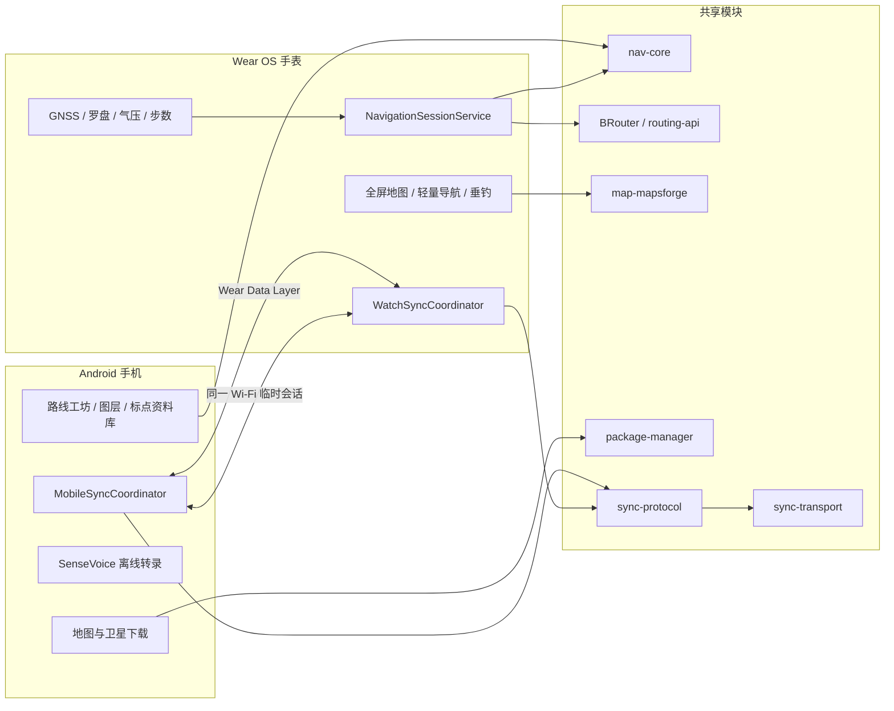
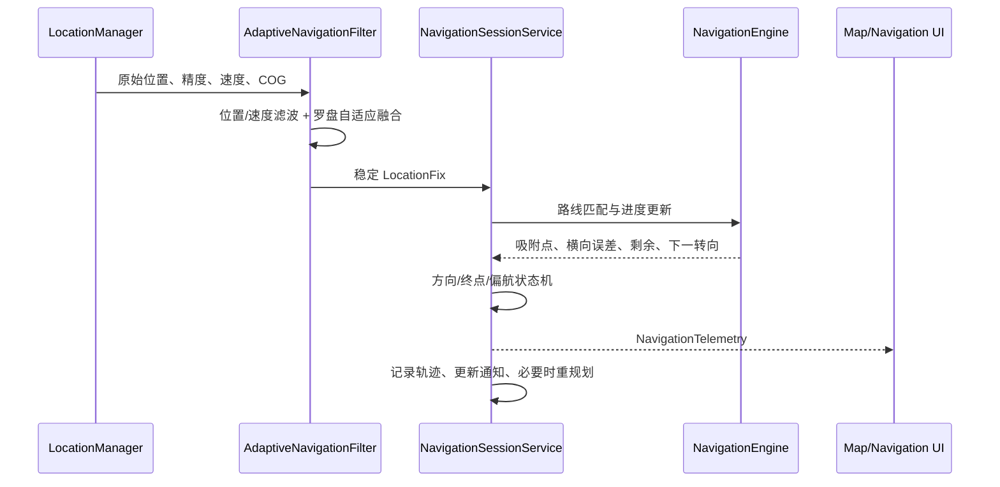
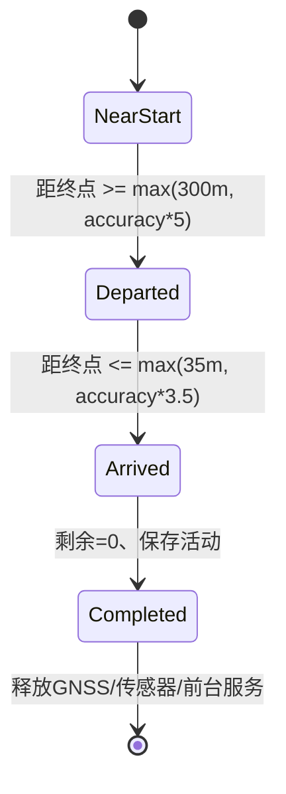

# WatchNav 0.20 技术架构与实现说明

文档版本：1.0

基线：Wear OS `0.20.35` / Android Companion `0.20.26-companion`

更新日期：2026-08-17

## 1. 系统目标

WatchNav 解决三个相互关联的问题：

1. 在无蜂窝网络、手机不可用的户外环境中，由手表独立完成地图、路由、导航和记录。
2. 把地图下载、路线整理、影像对比、资料归档和语音识别等重任务放到手机。
3. 在 Google Data Layer 不可用、手机运行于三星安全文件夹等情况下，仍可通过同一 Wi-Fi 完成受控同步。

设计约束：

- 手表导航主循环不能依赖手机响应。
- 地图、路网和路线在接收端校验完成前不能替换当前可用版本。
- 低速步行不能仅使用相邻 GNSS 点差分计算方向。
- 圆屏可点击区域与可见图形分离，边缘控件必须保留足够触摸面积。
- 导航完成或用户退出后必须释放 GNSS、传感器、前台服务和渲染资源。
- 精确钓点、轨迹、录音和照片默认不上传云端。

## 2. 总体结构



## 3. 模块边界

### 3.1 `nav-core`

纯 Kotlin 导航内核，不依赖 Android UI：

- `GeoPoint`、球面距离、初始方位角和坐标换算。
- GPX/KML 解析与写出，禁用 XML 外部实体；支持航点和路线扩展。
- WGS-84、GCJ-02、BD-09 相互转换，所有内部导航数据归一为 WGS-84。
- 路线分段、累计里程、空间索引、匹配、转向点生成和偏航状态。
- 海拔剖面、坡度、累计爬升和路线简化。
- `CourseMatcher` 保存稳定进度，避免相邻/重叠路线段导致进度反跳。

### 3.2 `brouter-engine` 与 `routing-api`

- `routing-api` 定义与 UI 无关的 `RouteRequest`、`RouteResult` 和 profile。
- `brouter-engine` 嵌入 BRouter，读取 5°×5° `.rd5` 离线路网。
- 默认按步行 profile 规划，不套用机动车通行逻辑。
- 起终点先生成多个候选投影，综合路网距离、目标方向和明显反向惩罚，减少隔墙或错误入口直连。
- 当前定位不在路线时，先规划到合适的路线接入点；偏航后只生成临时接驳段，不修改路线库中的原始路线。

路网仍受源数据质量限制。小区门禁、内部步道或临时封闭若未写入离线路网，应用无法凭空获知，必须通过更新 `.rd5`、标点或人工路线修正。

### 3.3 `map-mapsforge`

- 管理普通底图与等高线图层的独立选择状态。
- 地图栈按覆盖范围判定是否可用，避免无覆盖文件遮住有数据的底图。
- 大于 128 MiB 的图只在需要时打开，切换/离屏后主动释放读取器和瓦片缓存。
- 导航默认 zoom 17；定位点保持固定像素大小，不随地图缩放变成不可见小点。
- 计算覆盖边界对应的最小缩放，防止把地图拖到屏幕外或缩成无限空白区域。
- 等高线大图只围绕当前位置维护局部窗口，移动超过阈值后重建，降低 558 MiB 级图层的内存压力。

### 3.4 `package-manager`

- HTTPS 下载、重定向限制、超时和最大体积约束。
- HTTP Range 续传与 `.part` 临时文件。
- SHA-256、声明大小、剩余空间与安装安全余量校验。
- Ed25519 区域清单验证、staging、原子安装和旧版本回滚。
- Mapsforge、等高线和 BRouter 路网分别安装，不用“地图下载完成”掩盖路网缺失。

### 3.5 `session`

导航运行时的唯一权威状态：

- `NavigationSessionService`：前台定位、路线匹配、提示、偏航重算、活动记录和完成状态。
- `AdaptiveNavigationFilter`：二维位置/速度滤波、低速航向融合、位置死区与航向滞回。
- `OutdoorSensorFusion`：旋转向量、地磁真北修正、气压高度和垂直速度。
- `PedestrianRouteDirectionEstimator`：结合步数、沿线进度位移和罗盘，判断用户沿路线前进还是后退。
- `TrackStore` / `ActivityArchive`：采样轨迹、GPX/FIT/JSON 活动归档。
- `FinishArrivalDetector`：独立于临时接驳路线进度的终点返回状态机。

### 3.6 `sync-protocol` 与 `sync-transport`

- 协议模型为纯 Kotlin，可由手机和手表共用。
- 传输层同时实现 Wear Data Layer 和局域网临时会话。
- 业务数据先持久化到本地仓库；传输层不是数据库。
- 接收文件先进入 staging，校验长度和 SHA-256 后才交给类型安装器。

### 3.7 `watch-app` 与 `mobile-app`

`watch-app` 负责圆屏输入、地图/导航/垂钓视图和手表本地下载。`mobile-app` 负责路线工坊、图层目录、历史影像、标点资料页、手机长期仓库和离线语音识别。两者使用相同 applicationId 与签名以支持 Wear Data Layer，但保持各自完整本地副本。

## 4. 导航数据流



### 4.1 低速定位与航向

低速步行时，3–8 m 的 GNSS 漂移可能大于实际位移。当前实现采用以下策略：

- 速度 `≤0.3 m/s` 时罗盘主导；`≥0.8 m/s` 时逐渐提高 GNSS COG 权重。
- 静止且位移 `<5 m` 时应用位置死区。
- 航向变化超过 `10°` 并持续 `1.5 s` 后才提交普通转向；大转身使用更快响应。
- 位移航向需要至少 8–15 m 基线，并限制样本年龄，避免拿单次漂移判断行进方向。
- 罗盘读数若与可信运动方向相差超过 `90°`，降低其权重并提示远离金属干扰。
- 三星 Rotation Vector 已包含倾角补偿；在有经纬度和时间时再做磁偏角到真北的修正。

### 4.2 前进/后退判定

仅看“船头”无法判断用户沿同一条线向前还是向后。`PedestrianRouteDirectionEstimator` 使用证据累计：

- 至少 3 步后，比较真北罗盘与路线正/反方向的夹角。
- 至少 4 步并产生 8–20 m 的稳定沿线位移后，加入 GNSS/路线进度证据。
- 证据达到阈值才切换方向，避免一次错误定位导致整条路线翻转。
- 屏幕边缘刻度使用同一真北基准；地图、路线与 N 刻度处于同一坐标系。

### 4.3 路线接入与偏航重规划

1. 选中路线后，以当前定位为起点、路线合适接入点为终点运行步行规划。
2. 接驳段与原始路线合并为本次活动路线，地图以紫色显示。
3. 横向误差达到 `max(100 m, accuracy × 1.5)` 且超过 5 分钟冷却后才允许自动重规划。
4. 临时重规划只服务当前会话；下载路线和优秀路线保持不可变。
5. 重规划失败时继续显示真实位置、最后路线和到路线的面包屑连接，不清空导航 UI。

### 4.4 终点到达状态机

旧实现只依赖当前 `NavigationEngine` 的剩余距离。自动重规划会用临时接驳路线替换引擎并把进度清零，造成用户已经到达却仍显示 1.2 km。

新状态机独立保存原始路线终点：



- 离开半径限制在 300–500 m，到达半径限制在 35–150 m。
- 恢复进程时用已保存轨迹重新建立“已经离开过终点”的事实。
- 终点 200–300 m 范围内禁止自动接驳重规划。
- 路线匹配进度超过 75% 后，另有 20–60 m 精细终点吸附。
- 环线在刚开始时不会因起终点重合而立即结束。
- 完成后先归档 GPX/FIT/JSON，再清除活动会话并停止后台资源；前台仍保留“路线已完成”状态。

## 5. 地图与图层

### 5.1 图层类型

| 类型 | 格式/实现 | 主要用途 |
|---|---|---|
| 普通矢量图 | Mapsforge `.map` | 道路、水体、建筑、POI |
| 等高线 | Mapsforge `.map` 独立叠加 | 地形、坡度与高度参考 |
| 当前卫星图 | MBTiles | 枯水结构、河道与地物参考 |
| 历史影像 | MBTiles/用户授权资料 | 多时相比较 |
| 海图/水深/边界 | 可传输资料与后续专用渲染 | 水域辅助判断 |
| 路网 | BRouter `.rd5` | 离线步行规划，不直接渲染 |

### 5.2 图层选择规则

- 底图和等高线是两个独立开关；关闭等高线不会清空普通底图选择。
- 多张普通地图均保留清单，用户明确选择当前地图。
- 只有覆盖当前定位/路线区域的图层参与渲染。
- 切换图层后保持定位居中和合理缩放。
- 手表接收手机地图后不覆盖唯一可用旧地图，只有安装成功才切换。

### 5.3 卫星图

默认当前卫星层使用 EOX Sentinel-2 Cloudless 2025：

- 半径 1–15 km，Web Mercator z10–z16。
- 最多 6000 个瓦片，4 线程下载，单瓦片最多重试 3 次。
- 直接写入 MBTiles，已有瓦片跳过，实现任务级恢复。
- 保存来源、年份、许可和 `EOX · Contains modified Copernicus Sentinel data 2025` 署名。
- 该数据适合大尺度结构参考，不等同于亚米级商业航拍。

### 5.4 大图性能

- 手机可保留完整区域；手表优先使用定位附近小范围。
- Mapsforge 大文件按需打开并限制缓存，地图切换时关闭旧数据源。
- 地图边缘始终约束在屏幕内；最小缩放不能继续露出无限空白背景。
- 导航页不持续渲染完整地图，只画局部路线、少量分叉和最近面包屑，降低 GPU/CPU 与发热。

## 6. 手机—手表同步

### 6.1 实体协议

`SyncRecord` 包含：

```text
id, type, revision, updatedAtUtcMillis, updatedBy,
deleted, contentType, payload, contentHash
```

支持路线、标点、垂钓记录、活动、设置、潮汐、图层来源和公共 POI。相同 revision 且哈希不同的并发修改保留两份，不静默覆盖。

### 6.2 文件协议

`TransferManifest` 描述地图、等高线、路网、历史影像、海图、水深、路线、活动和录音：

- `packageId + version + sha256` 去重。
- 默认 4 MiB 分块；接收端每 16 MiB 持久确认。
- 安装前至少预留文件大小之外的 128 MiB 空间。
- 失败和中断保留可恢复状态；超过 7 天的无效临时文件才允许清理。

### 6.3 Wear Data Layer

- DataClient：小型实体与清单。
- MessageClient：在线命令、状态查询和确认。
- ChannelClient：地图、路网、录音等文件流。
- 两端必须 applicationId 和签名一致。

### 6.4 局域网直连

用于安全文件夹或 Google Play 服务通道不可用的情况：

1. 用户在手表打开“接收”窗口，窗口有效 3 分钟。
2. 手表在 UDP 39876 响应发现请求，并返回临时 TCP 端口和 128-bit 随机会话令牌。
3. 手机连接后交换 hello、实体批次和文件。
4. 单文件仍执行体积、空间和 SHA-256 校验。
5. 传输结束或超时后服务器关闭，不保留永久监听端口。

局域网协议当前用于可信家庭/办公局域网内的配对设备，不应把端口映射到公网。

## 7. 垂钓数据链路

### 7.1 手表现场记录

- 垂钓页一次只突出一个指标，避免圆屏文字重叠。
- 麦克风按钮录制 16 kHz 单声道 PCM WAV，同时保存坐标、时间与环境快照。
- 原始音频不在手表做文字识别，降低 CPU、内存和耗电。
- 录音与快速标点进入同步队列，手机不在线时继续本地保存。

### 7.2 手机资料页与转录

- 手机收到 WAV 后先长期保存原文件。
- SenseVoiceSmall int8 模型在手机端按需下载，校验固定 SHA-256。
- 单线程识别避免同时装载多个大模型；空闲 30 秒释放模型资源。
- 按记录 ID，或 5 分钟/25 m 范围内最近标点自动关联。
- 自动转录写入独立字段，不覆盖用户手工备注；用户可修改并添加照片。

### 7.3 环境指标

- BARO：绝对气压与趋势；3 小时快速下降用于风暴风险提示。
- O₂：基于可用环境数据的决策辅助估算，不冒充水质传感器实测。
- TIDE：缓存潮高曲线、涨退阶段和高潮/低潮；转流参考窗口为前后 15 分钟。
- ACT：日月时角与主/次活跃期形成四级活性。
- SUN：日出、日落和晨昏窗口。
- CASTS：抛投计数与无咬口节奏提醒。

## 8. 功耗和资源生命周期

| 场景 | 策略 |
|---|---|
| 地图浏览 | 无导航时不启动前台 GNSS 服务；渲染器按界面生命周期释放 |
| 导航前台 | 根据精准/均衡/远征模式选择定位周期 |
| 熄屏 | 降低 UI 刷新；保留必要定位与轨迹记录 |
| 轻量导航页 | 不加载完整大图，只画必要几何 |
| 大文件同步 | 用户可见窗口、低电/过热/空间不足时暂停 |
| 到达终点 | 归档后自动移除定位更新、停止传感器和前台服务 |
| 退出 App | 停止导航与常驻服务，释放地图、数据库和执行器 |

不应通过永久常驻空进程解决启动速度。地图索引和用户数据持久化，进程可在需要时重建；只有正在导航或显式传输时才允许前台服务常驻。

## 9. 数据安全和隐私

- GPX/KML XML 禁用 DTD 与外部实体。
- 网络下载限制 HTTPS、重定向次数、响应体大小和文件总大小。
- 区域包校验声明大小、SHA-256 和签名。
- 精确钓点、照片和音频默认本地保存；分享时应允许坐标模糊化和 EXIF 清理。
- API key 不进入同步记录和日志。
- 图层必须记录许可、署名和是否允许离线/再分发。
- 调试输出、设备 dump、真实 IP、APK、地图和语音模型不提交源代码仓库。

## 10. 构建、测试与发布

### 10.1 构建矩阵

```powershell
.\gradlew.bat test assembleDebug
.\gradlew.bat :watch-app:lintDebug :mobile-app:lintDebug
```

Java 17，compileSdk 36，targetSdk 35，minSdk 30。

### 10.2 自动测试重点

- 坐标系转换、GPX/KML、路线操作与导航指令。
- 路线匹配、终点重叠、终点进度保护。
- 自适应位置/航向、前后方向证据和转向显示策略。
- 等高线/普通地图栈选择和卫星瓦片覆盖。
- 路网/地图断点下载与校验。
- 同步编解码、冲突策略和转录数据关联。

### 10.3 真机回归清单

1. 室外冷启动取得 GNSS，N 刻度与已知真北对照。
2. 低速步行、原地转身、沿路线正走/反走。
3. 当前定位到路线起点的步行规划与门禁/入口合理性。
4. 偏航超过阈值后的接驳路线，回到原路线后的剩余距离。
5. 到达终点后剩余归零、活动归档、服务与 GNSS 释放。
6. 普通/等高线/卫星切换、平移边界和大图连续操作。
7. 手机发送路线、手表主动接收、地图/路网双向盘点。
8. 手表语音钉到手机、SenseVoice 转录、资料页关联和编辑。
9. Wear Data Layer 与局域网直连分别测试。
10. 2–4 小时导航的温度、电量、崩溃、ANR 和内存趋势。

## 11. 当前已知边界

- 离线步行路线正确性取决于 `.rd5` 中的 OSM 道路、门禁和 access 标签。
- GPS 处于城市峡谷、密林或大面积水面反射环境时，终点半径会根据 accuracy 放宽；界面必须继续显示精度信息。
- 全球中分辨率卫星/水深数据不能替代高分辨率航拍、测深仪或官方海图。
- 历史影像、ENC、GeoTIFF 等格式的完整统一渲染仍需逐源验证许可与解析器。
- 局域网直连是附近设备的补充通道，不是互联网同步或账号体系。
- Release 构建的签名、密钥管理、商店发布和数据迁移仍需独立发布流程。

## 12. 重要实现决策

1. **原始路线不可变**：重规划产生临时会话路线，路线库不被覆盖。
2. **终点状态独立**：不能把“当前引擎剩余距离”当作唯一到达依据。
3. **方向多源融合**：低速使用罗盘与步数，高速使用 GNSS COG，没有单一永远可信的航向源。
4. **地图图层分离**：底图、等高线、卫星与路网各自建模，不再用一个“active map”代表全部状态。
5. **手机增强而非依赖**：手机可完成重任务，但手表失联后仍有完整离线闭环。
6. **传输后安装**：收到字节不等于可用；只有校验、解析和原子提交成功才回执“已安装”。
7. **完成即释放**：到达终点是资源生命周期的终止状态，不允许后台继续耗电。
