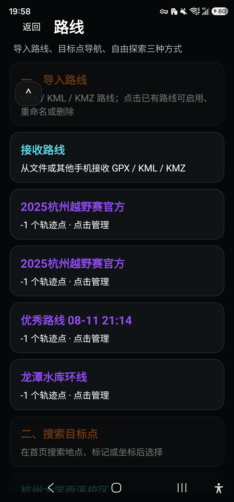
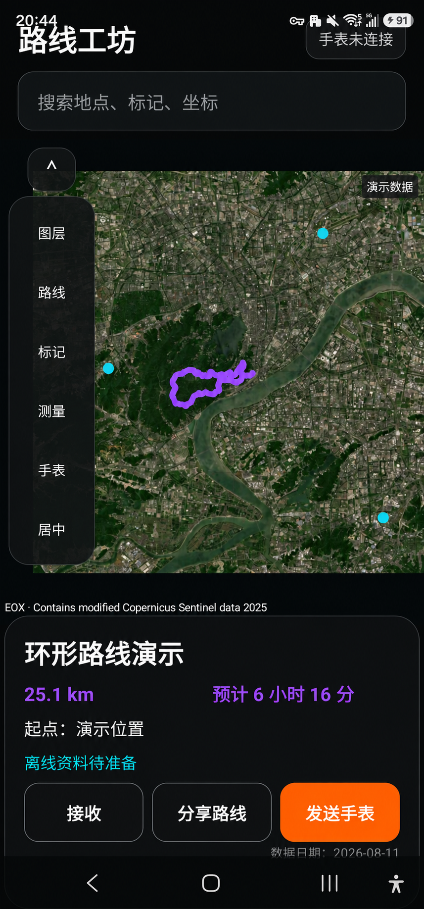
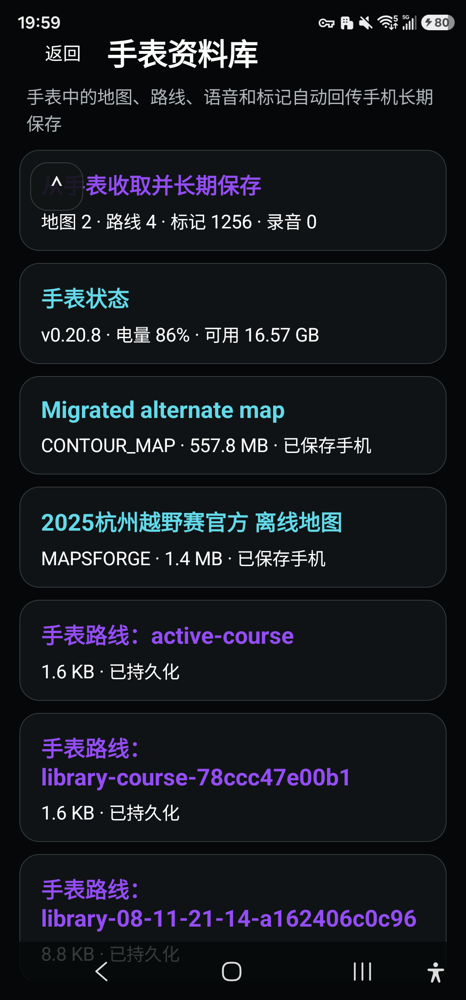
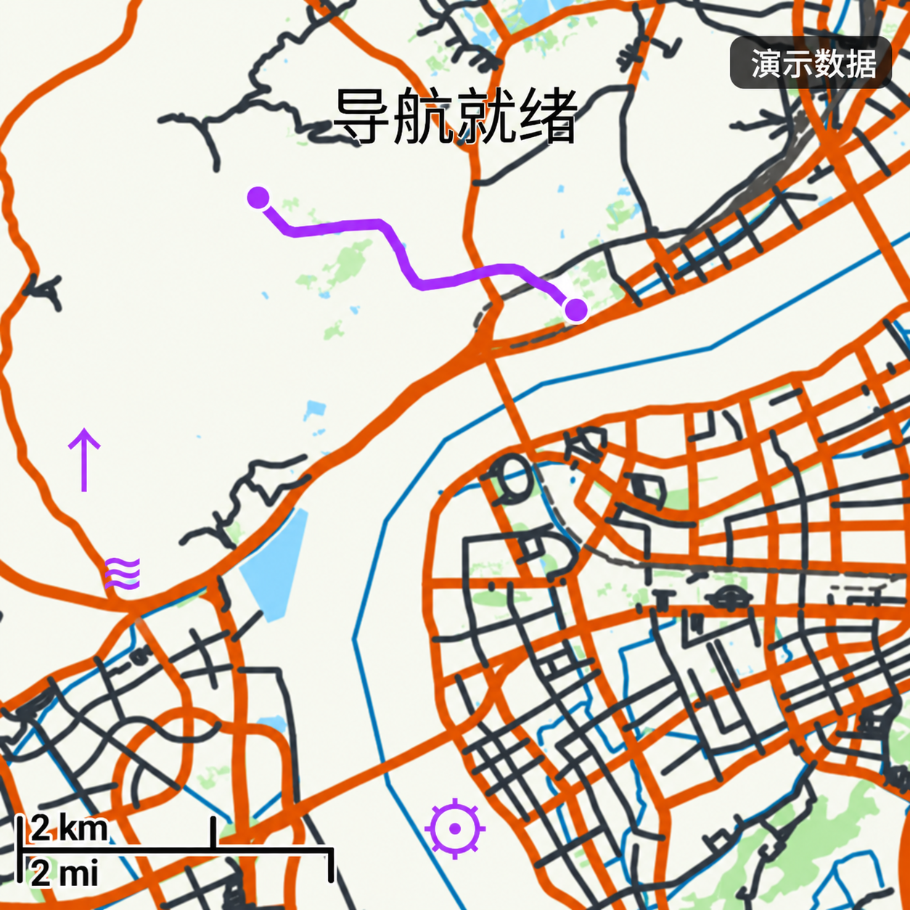
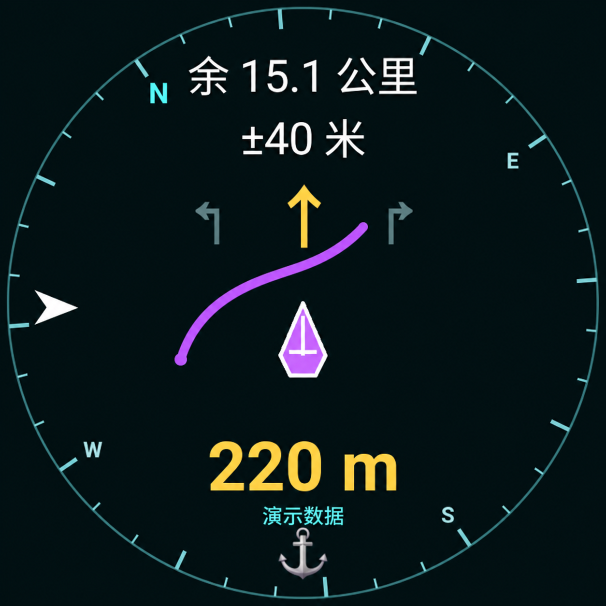
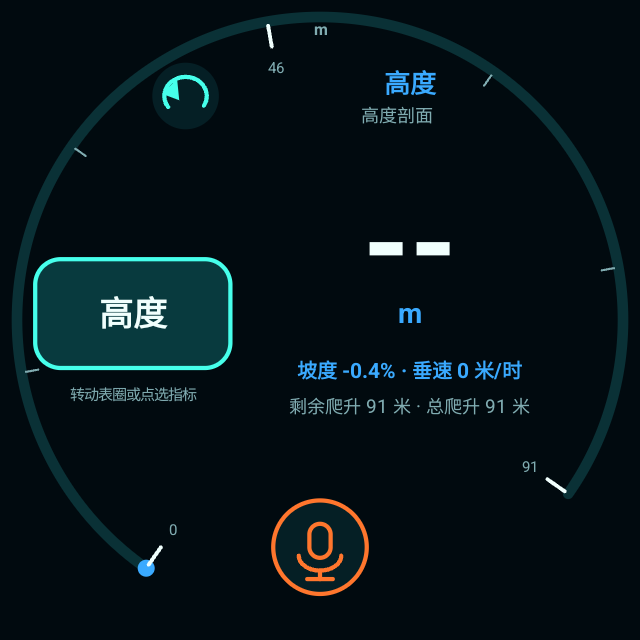

# WatchNav 手机与手表图文手册

适用：手表 0.20.39、手机 0.20.26-companion。发布整理日期：2026-10-25。

图片说明：界面基于历史真机截图，公开版本保留环形路线，其余地图圆点、非环形连线及具体起点名称经过演示化处理。随机演示标点和路径不对应真实位置或活动，不可用作实际导航。

## 1. 下载与准备

到 [最新 Release](https://github.com/yzgpk2002/watchnav/releases/latest) 下载手机 APK、手表 APK，以及需要的地图资源。手机需要 Android 11 或以上、arm64；手表需要 Android 11 / API 30 或以上的 Wear OS，主要测试设备是 Galaxy Watch7。华为非 Wear OS 手表不能安装本 APK。

两个 APK 的包名同为 `com.watchnav.app`，分别用于不同设备，便于 Wear Data Layer 通信。请按照文件名区分 `phone` 和 `watch`。当前提供的是开发侧载签名包，安装时系统可能提示未知来源；升级应使用相同签名的包。不要为解决安装问题直接清除旧数据，应先备份路线、地图和标记。

## 2. 手机安装

1. 在手机浏览器下载 `WatchNav-phone-*.apk`。
2. 点击下载文件，按 Android 提示允许当前浏览器或文件管理器安装未知应用，然后安装。
3. 打开 WatchNav，授予定位权限。使用录音、图片等功能时再授予相应权限。
4. 建议先装在普通空间。三星安全文件夹是独立应用空间，普通空间与安全文件夹中的连接和资料互不等同；Data Layer 不通时可使用下文的局域网同步。

## 3. 手表侧载安装

可用 Wear OS Tools、电脑 ADB 或甲壳虫 ADB。以下是电脑 ADB 的通用步骤。

1. 手机与手表连接同一 Wi-Fi，确认 Wi-Fi 没有开启客户端隔离。
2. 手表「设置 → 关于手表 → 软件信息」，多次点击软件版本开启开发者选项。进入开发者选项，启用 ADB / 无线调试。
3. 选择「使用配对码配对」，记下配对 IP、端口和配对码。在电脑运行 `adb pair IP:配对端口`，输入配对码。
4. 回到无线调试主页面，记下连接端口，运行 `adb connect IP:连接端口`。**配对端口与连接端口通常不同。**
5. 运行 `adb devices -l` 确认设备为 `device`，然后安装：

```powershell
adb -s 192.168.1.100:40000 install -r WatchNav-watch-v0.20.39.apk
adb -s 192.168.1.100:40000 shell dumpsys package com.watchnav.app
```

示例地址必须换成当前手表地址。安装后应看到 `versionName=0.20.39`、`versionCode=64`。首次启动授予定位权限，录音功能需要麦克风权限。甲壳虫 ADB 也可在配对和连接后选择同一个手表 APK 安装。

已配对后通常只需重新连接。路由器或端口变化时使用 ADB mDNS 发现；Windows 开发调试细节见 [无线调试指南](WINDOWS_WEAR_DIRECT_DEBUG.md)。安装完成可关闭无线调试以减少耗电。

## 4. 先在手机准备离线资料



手机主菜单中的路线支持导入路线、搜索目标和自由探索。通过系统分享打开 GPX/KML/KMZ，或使用「接受」入口导入；导入时确认坐标系。标准 GPX 通常为 WGS-84；只有明确来自 GCJ-02 / BD-09 的文件才选择转换，重复转换会造成偏移。

图层中选择普通、等高线或卫星地图；下载设置控制范围。地图提供画面，BRouter `.rd5` 提供步行路网，两者要覆盖同一区域。仅下载地图不能保证离线路由可用。大文件优先在手机 Wi-Fi 下完成，再发送手表。卫星图下载耗时取决于区域、缩放级别和图源速度，下载中可保留任务继续续传。



手工下载的 `.map` / `.mbtiles` 通过文件接受入口导入，资源类型会自动识别。若系统文件选择器没有显示某扩展名，可从文件管理器分享给 WatchNav。具体格式与来源见 [地图资源说明](MAP_RESOURCES.md)。

## 5. 手机与手表同步



先通过 Galaxy Wearable 完成正常手机—手表配对，打开两端 WatchNav。手机进入手表资料库查看连接、路线、地图、标记、录音和活动资料；通过「发送手表」传输选中资料。手表已有资料也可回传到手机长期保存。地图大文件需等待传输及安装回执，不能只以发送按钮点击成功判断完成。

若 Wear Data Layer 不通，两端连接同一 Wi-Fi，在手表开启局域网接收窗口，再从手机扫描和连接。接收窗口是临时会话；超时后重新开启。路由器客户端隔离、不同子网或安全文件夹权限可能影响发现。手机发送路线后，手表路线库中的「接收路线」可用于主动检查；传完后在路线库核对名称并选择。

## 6. 手表地图与导航

| 全屏地图 | 轻量导航示例 |
|---|---|
|  |  |

地图页显示普通、等高线或卫星底图，紫色准心代表位置，紫线代表路线。使用路线图标打开列表；列表中是导入/下载或手动保留的路线，自动记录位于功能中的历史记录。选择路线后，App 根据当前位置和离线路网规划到 **GPX 声明的起点**。

当前版本采用两阶段接驳：先抵达 GPX 起点并结束接驳；在起点再次选择并启动该路线，可继续沿 GPX 行走。接驳不是整条 GPX 已走完。若路网缺失或不能规划，应检查路网覆盖范围，不能把地图上的直线视作可行道路。

点击地图的导航箭头进入导航页。导航页显示真北方位刻度、剩余距离、定位精度及偏航距离；超过 60 m 时偏航字变红并声音/振动报警，回到约 45 m 内复位。导航页的边缘滑动或硬件旋转输入用于缩放。截图中的旧转向组件在当前版本已取消，以实际安装界面为准。

低速时方向主要由电子罗盘提供；远离磁性表带、金属和强磁场，按提示做 8 字校准。GNSS 信号好也不能消除磁干扰。室内可显示最后定位，但最后定位不等于当前实时位置；到室外等待新定位后再出发。

到达判断独立于是否沿规划线行走，按定位精度设置到达范围。户外复杂地形应同时核对坐标、现场道路和路线方向。

## 7. 自由探索、历史与垂钓录音

路线库第一项「自由探索」会清除当前显示路线并开始记录；结束时选择「结束探索」，活动进入历史记录，可保留为路线。导航停止或退出后，应检查通知栏没有仍在运行的导航服务。



导航页船锚入口进入垂钓界面，返回按钮回到导航。左侧滚动文字选择气压、活性、潮汐、日出日落、抛投或高度等指标；功能设置可调整指标种类。底部麦克风保存原始音频，同时自动关联坐标和时间。

连接手机后，在手机手表资料库的对应标点资料页查找录音。手机安装/下载 SenseVoiceSmall int8 模型后执行离线转录，文字进入备注；原始录音保留，可修改文字、标点名称并添加图片。没有真实水温/溶氧传感器时，溶氧是估算值；潮汐及 Solunar 为辅助预测，不能当作实测或保证咬口的概率。

## 8. 常见问题

| 现象 | 检查方法 |
|---|---|
| 地图空白 | 图层是否正确、地图是否覆盖当前坐标、文件是否已完整接收；从已有地图列表切换 |
| 规划失败 | `.rd5` 是否覆盖起终点与途经区域；地图文件本身不包含 BRouter 路网 |
| 路线出现在外地 | 确认原文件坐标和坐标系，避免对 WGS-84 再做纠偏 |
| 手机没有收到标记 | 打开手表接收/同步会话，检查手机对应标点资料页及传输回执 |
| 手表温热/耗电快 | 下载、安装地图在充电且散热良好时完成；关闭无线调试、结束导航或用退出 App 释放服务 |
| 到达仍有剩余 | 确认本次目标是 GPX 起点还是路线终点，保留版本号、定位精度和活动日志以便复现 |
| 无法覆盖安装 | 检查是否装错手机/手表包，或签名不一致；先备份，勿直接清除数据 |

本次公开发布重跑自动测试与构建；真机图片和验证记录来自此前开发回测，未把它们表述为 2026-10-25 新的户外测试。
